# Visual changelog

## v0.10 beta — 2026-11-17 · Two more blue icons

### Added

- Two blue UI-art icons using the supplied **version-one** designs: a plant/root-style motif (`item-000-096.png`) and a key-style motif (`item-064-096.png`).

### Changed

- The README equipment screenshot now shows the v0.9 artwork.

HD Fonts remains unchanged at **101 PNGs**. HD Fonts + UI Art has **163 PNGs**;
all 161 previously released textures are unchanged. Artwork remains a work in
progress. The two new sprites retain their original source-cell bindings;
their natural-gameplay uses are unconfirmed.

Art direction and interpretation by diodiogod.

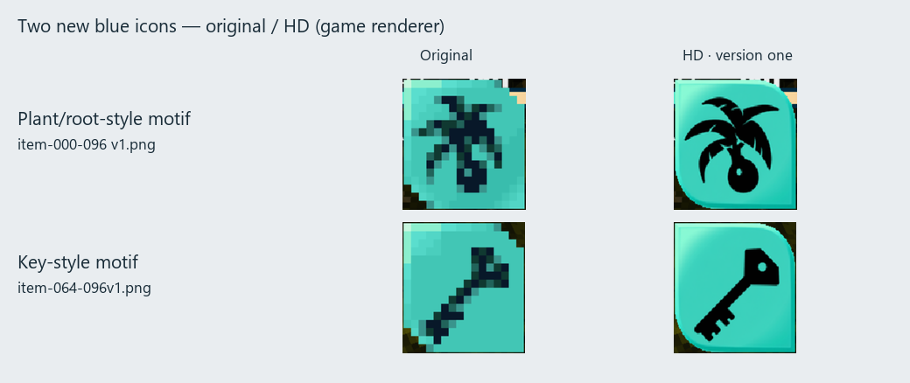

Both icons passed controlled Windows Vulkan checks at native and 2x size, with
opaque black silhouettes and no changes outside the four draw regions.
Android device testing of this release is pending.

## v0.9 beta — 2026-11-07 · Menu artwork progress

The optional **HD Fonts + UI Art** edition adds more menu artwork while the
remaining sprites are being made. **HD Fonts** keeps its original non-letter
artwork; both editions share the same unchanged 101 font textures.
Art direction and interpretation by diodiogod.

### Category tabs

All eight tabs use the final orange badge artwork with matching turquoise
inactive states. Supplied outlines and placement are retained, including the
separate equipment Gem and circular Gems category badge.

| Category | Artwork |
| --- | --- |
| Weapons | Crossed weapons on the round badge |
| Blades | Detached blade symbol on the round badge |
| Grips | Maintainer-selected grip symbol on the round badge |
| Shields | Shield symbol on the round badge |
| Armor | Armor silhouette on the round badge |
| Gems | Gem contour on the round badge |
| Misc | Misc symbol on the round badge |
| Options | Exclamation on the square badge |

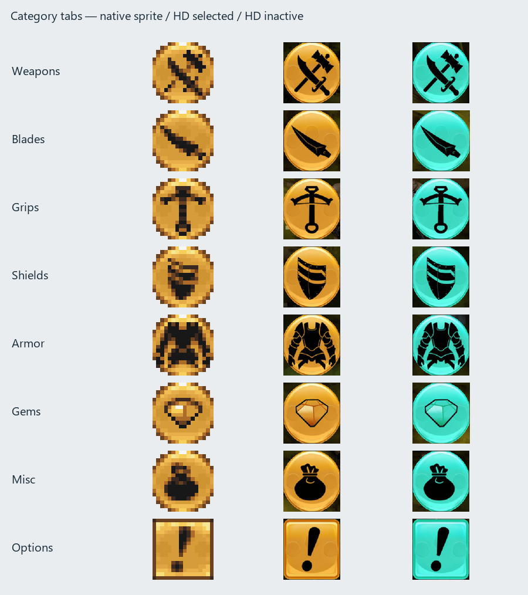

### Equipment and grips

| Icon | Addition |
| --- | --- |
| Short Grip | Detached hilt for daggers, swords and great swords |
| Long Grip | Long handle for axes, maces and staves |
| Polearm Grip | Polearm handle silhouette |
| Crossbow Bolt | Bolt symbol in the fourth grip category |
| Axe & Mace | Weapon-category silhouette |
| Great Axe | Separate large-axe silhouette |
| Staff | Staff silhouette |
| Heavy Mace | Distinct heavy-mace silhouette |
| Helm | Head armor silhouette |
| Breast Armor | Body armor silhouette |
| Leggings | Leg armor silhouette |
| Glove / Bare Hands | Shared native sprite for glove and unarmed entries |
| Accessory | Accessory silhouette |
| Gem | Equipment gem on the turquoise badge |

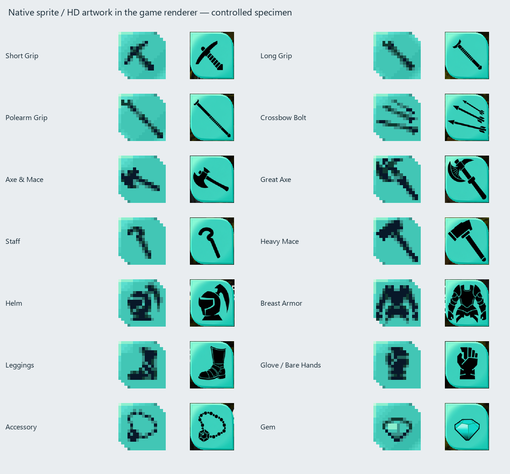

The six equipment designs from v0.8—Dagger, Sword, Great Sword, Polearm,
Crossbow and Shield—are retained unchanged.

### Controller buttons

| Prompt | Addition |
| --- | --- |
| Triangle | HD face-button icon |
| Square | HD face-button icon |
| Circle | HD face-button icon |
| Cross | HD face-button icon |
| L1 | Curved shoulder-button artwork and lettering |
| R1 | Curved shoulder-button artwork and lettering |
| L2 | Shoulder-button artwork and lettering |
| R2 | Shoulder-button artwork and lettering |

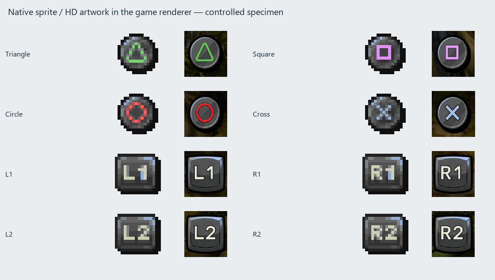

### Menu markers and attention symbol

- **EQP:** round equipped marker, with the original placement and readable lettering.
- **SET:** square set marker, retaining the supplied lettering and border.
- **Attention !:** separate black exclamation with a white surround; the balloon artwork is unchanged.
- **Additional Misc source graphic:** supplied turquoise artwork bound to `item-016-096.png`; its natural-gameplay use remains unconfirmed.

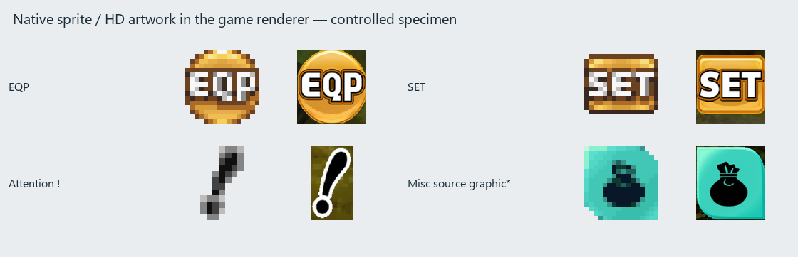

The earlier diagonal cursor, up arrow, three paper balloons, heart and emphasis
marks are unchanged and remain visible in the [v0.8 comparison](#arrows-speech-balloons-and-expression-symbols).

**Still a work in progress:** unfinished menu sprites retain their original
artwork. The art edition now contains 161 PNGs, including 60 optional artwork
textures. All 44 new or updated palette variants passed controlled Windows
renderer checks with zero changed pixels outside their draw regions. The newest
three designs and final archive still need Android device testing.
[Testing](docs/TESTING.md#v09-beta) · [Release notes](RELEASE-NOTES.md).

## v0.8 beta — Equipment and category badges (WIP)

The first badge batch adds the maintainer's Dagger, Sword, Great Sword, Polearm,
Crossbow and Shield designs, plus Grips and Shields category tabs. Remaining
badges keep their original artwork. The optional art edition also includes the
reviewed arrows, paper bubbles, heart and emphasis marks. Shared fonts are unchanged.

- **Dagger:** new black silhouette on the turquoise beveled badge.
- **Sword:** scimitar silhouette sized for the regular Sword slot.
- **Great Sword:** separate large-blade silhouette in its correct category slot.
- **Polearm:** spear silhouette with the maintainer's selected details.
- **Crossbow:** diagonal crossbow silhouette on the turquoise equipment badge.
- **Shield:** shield silhouette on the turquoise equipment badge.
- **Grips category:** the maintainer-approved hilt design on the round badge, with gold selected and turquoise inactive variants.
- **Shields category:** round shield badge with gold selected and turquoise inactive variants.
- **Diagonal cursor:** illuminated 3D shape with a visible underside and dark border.
- **Up arrow:** curved arrow-tip silhouette with a continuous gradient.
- **Normal speech bubble:** maintainer-supplied paper texture and black outline.
- **Low speech bubble:** maintainer-supplied wide paper bubble.
- **Spiky speech bubble:** maintainer-supplied burst shape and paper texture.
- **Heart:** maintainer-selected red heart with its white outline.
- **Emphasis marks:** selected three-stroke design with a thicker black border.

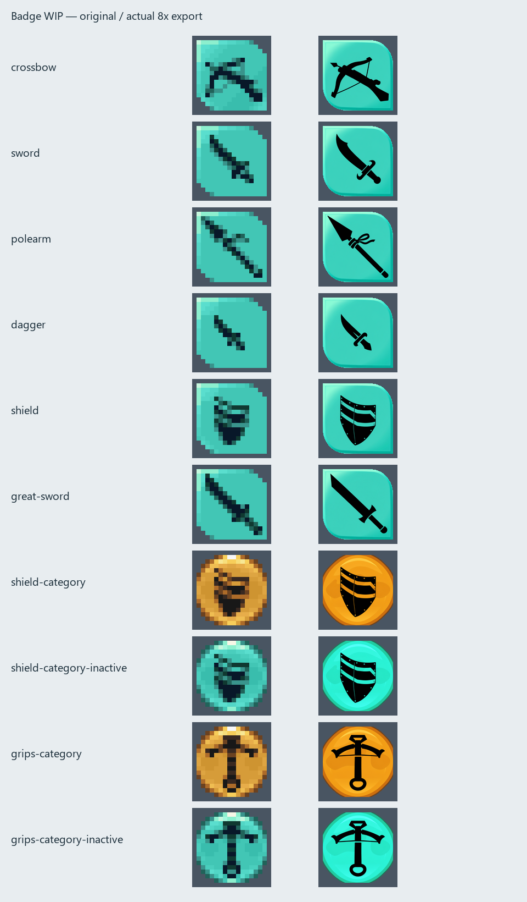

### Arrows, speech balloons and expression symbols

Original artwork on the left, HD artwork on the right, captured in the game
renderer. Includes both arrows, all three speech balloons, emphasis marks and
the heart.

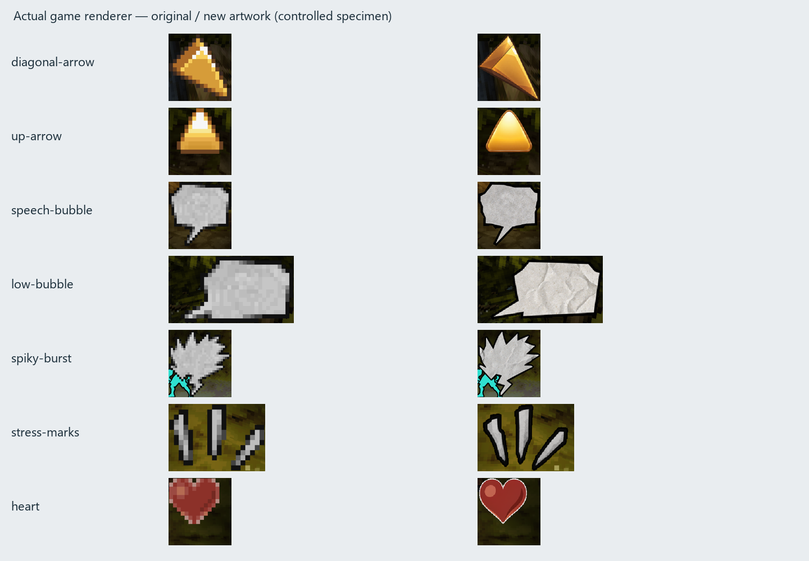

[Badge renderer comparison](docs/images/badges-rendered-v0.8.png). The maintainer tested the supplied Android package and reported it working well on 2026-10-24.

## v0.7 beta — 2026-10-20

Two complete editions share the same fonts. The art edition adds the material
badges and manually painted body-status sprites; the fonts edition keeps the
original pixel artwork. Both equipped and empty-hand poses are included.

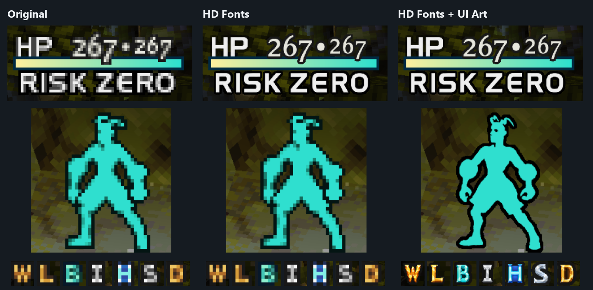

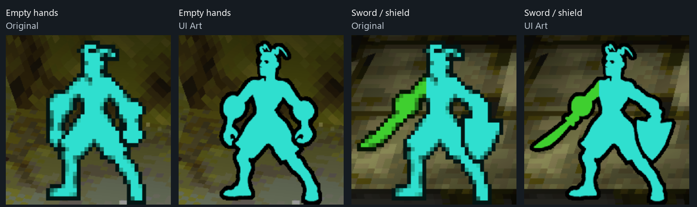

[Release notes](RELEASE-NOTES.md) · [Art direction](docs/ART-DIRECTION.md).

---

## v0.6 beta — 2026-10-17

- Added all seven material initials with reviewed metallic shading and thick dark borders.
- Kept the selected letter designs and corrected W to its original sprite footprint.
- 103 PNGs. The preceding 101 font files are unchanged.
- Includes the combat-text and popup-sign work recorded below.

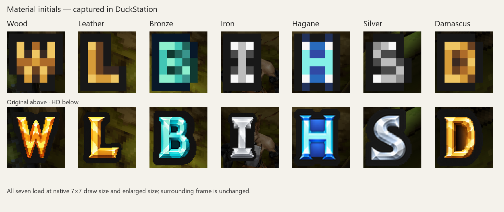

[Equipment-menu comparison](docs/images/equipment-materials-v0.6.png) · [Testing](docs/TESTING.md).

## v0.5 development — included in v0.6

- Added 66 fixed-word sprites: combat/status text, interaction notices and affinity popups.
- Reconstructed the original angled 5, asymmetric percent symbol and distinctive letter details.
- Kept native popup colours, dark surrounds and steady/flash effects.
- Sharpened the popup +/− signs with square dark borders.
- Checked all new sprites in Windows; word pairs and HP/MP numbers stay separate.

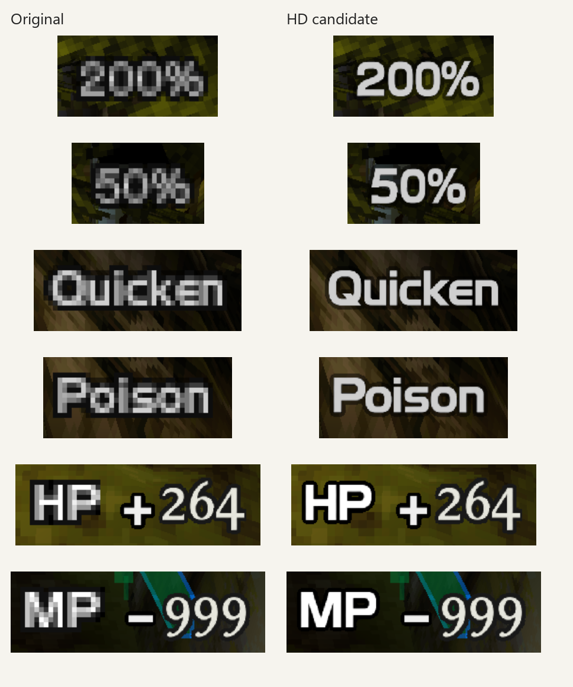

[Spacing comparison](docs/images/combat-spacing-v0.5.png) · [Fixed labels and coloured popups](docs/images/fixed-labels-v0.5.png).
[Popup signs](docs/images/affinity-signs-v0.5.png).

101 replacement PNGs. Dialogue and non-text artwork are unchanged.
The maintainer tested the preceding package on Android. The popup-sign
correction and broader gameplay checks remain pending there.

## [v0.4 beta](https://github.com/diodiogod/vagrant-story-hd-dialogue-font/releases/tag/v0.4-beta) — 2026-10-16

- Reconstructed MAP, SAVE, CLEAR and TIME.
- Restored dark surrounds on HP, MP, RISK and WT.
- Added a soft neutral glow to white menu text.
- Corrected spacing, baselines and character heights across the menu font.
- Checked the compact UI alphabet and digits; corrected spacing and two letter heights.
- Restored native dark surrounds across all 36 compact UI letters and digits.

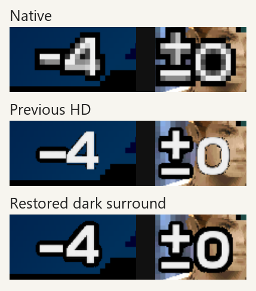

[Equipment-label comparison](docs/images/compact-ui-labels-v0.4.png).

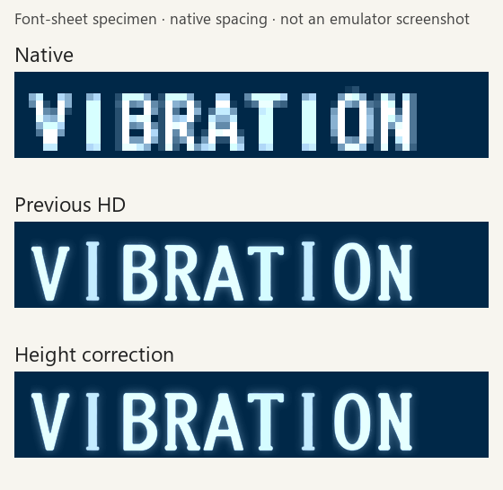

[Full alphabet comparison](docs/images/font-height-families-preview.png).
The INFORMATION heading's faint native-text ghost remains a [known issue](docs/TESTING.md).

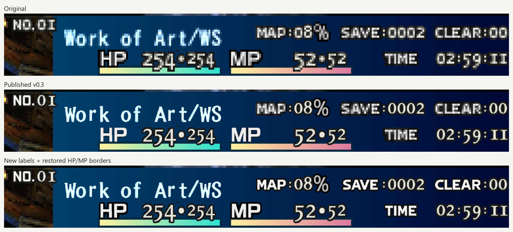

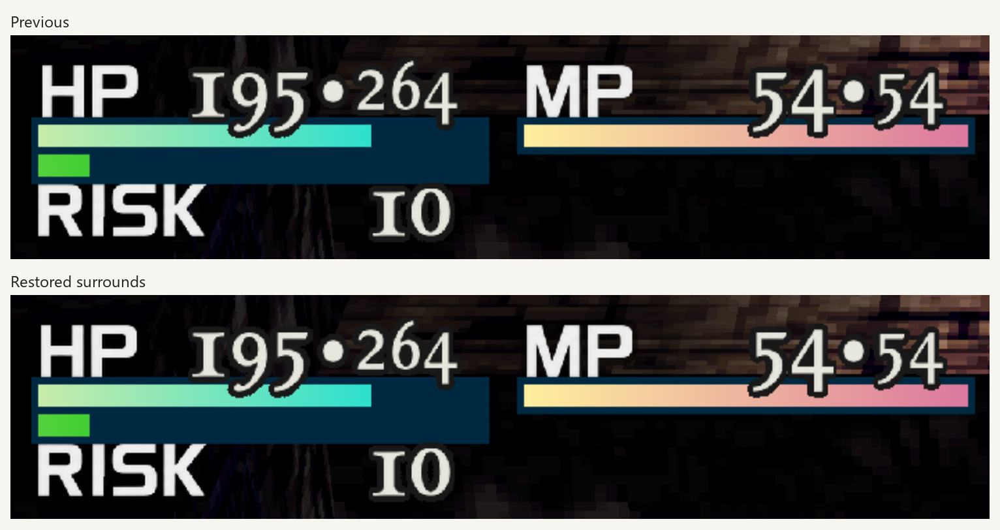

### Soft menu glow

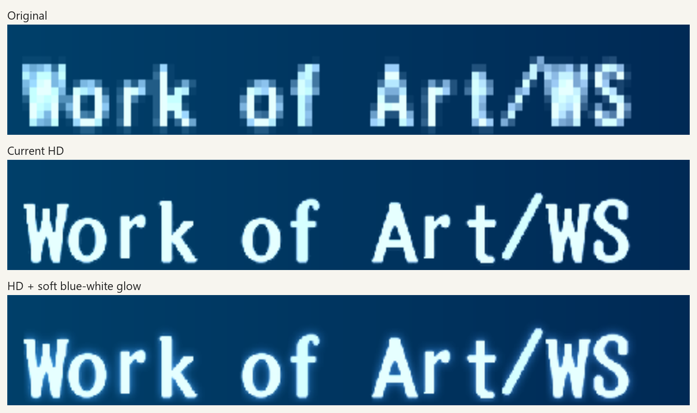

The glow stays grayscale, matching the original palette, and is shared by
save names and white menu text.
[Green-menu comparison](docs/images/green-menu-glow-preview.png).

59 replacement PNGs; the seven dialogue textures are unchanged.

## [v0.3 beta](https://github.com/diodiogod/vagrant-story-hd-dialogue-font/releases/tag/v0.3-beta) — 2026-10-15

- Added menu fonts, HUD letters/numbers, fixed labels and punctuation.
- Restored value-digit borders and sharpened the HP/MP separator.
- Added Android installation tips and the PGXP compatibility note.

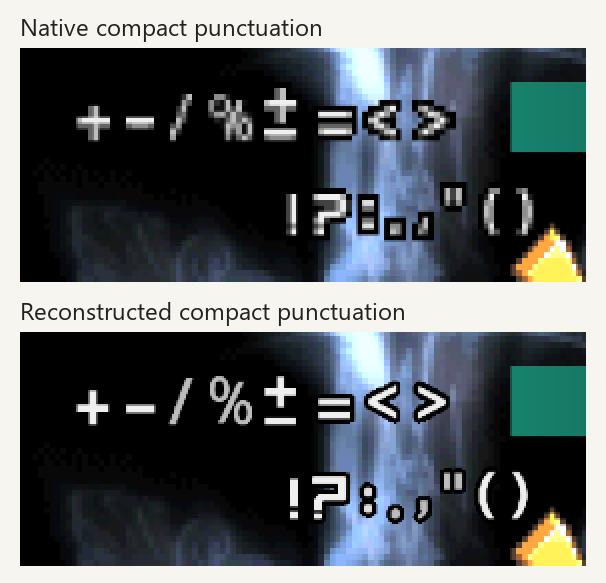

## [v0.2 beta](https://github.com/diodiogod/vagrant-story-hd-dialogue-font/releases/tag/v0.2-beta) — 2026-10-14

- First original-style dialogue release: 123 glyphs, seven palettes.

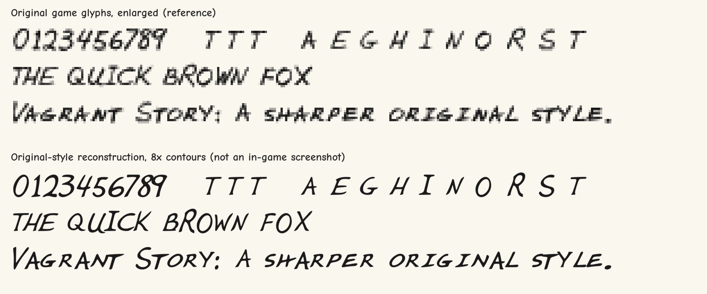
