# Visual changelog

## v0.8 beta — Equipment and category badges (WIP)

The first badge batch adds the maintainer's Dagger, Sword, Great Sword, Polearm,
Crossbow and Shield designs, plus Grips and Shields category tabs. Remaining
badges keep their original artwork. The optional art edition also includes the
reviewed arrows, paper bubbles, heart and emphasis marks. Shared fonts are unchanged.

- **Dagger:** new black silhouette on the turquoise beveled badge.
- **Sword:** scimitar silhouette sized for the regular Sword slot.
- **Great Sword:** separate large-blade silhouette in its correct category slot.
- **Polearm:** spear silhouette with the maintainer's selected details.
- **Crossbow:** diagonal crossbow silhouette on the turquoise equipment badge.
- **Shield:** shield silhouette on the turquoise equipment badge.
- **Grips category:** the maintainer-approved hilt design on the round badge, with gold selected and turquoise inactive variants.
- **Shields category:** round shield badge with gold selected and turquoise inactive variants.
- **Diagonal cursor:** illuminated 3D shape with a visible underside and dark border.
- **Up arrow:** curved arrow-tip silhouette with a continuous gradient.
- **Normal speech bubble:** maintainer-supplied paper texture and black outline.
- **Low speech bubble:** maintainer-supplied wide paper bubble.
- **Spiky speech bubble:** maintainer-supplied burst shape and paper texture.
- **Heart:** maintainer-selected red heart with its white outline.
- **Emphasis marks:** selected three-stroke design with a thicker black border.

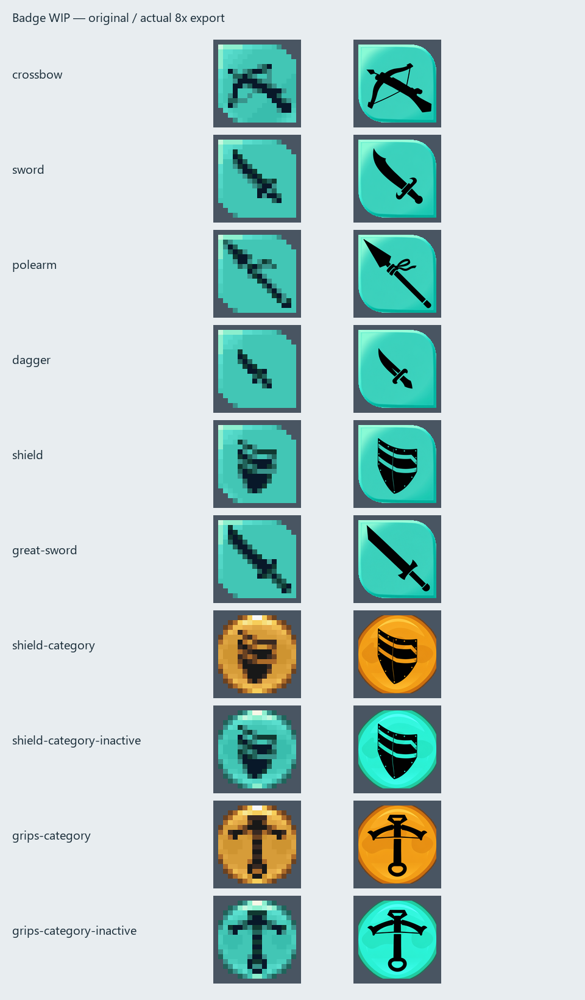

[Arrows and expressions in the renderer](docs/images/arrows-expressions-v0.8.png).
[Badge renderer comparison](docs/images/badges-rendered-v0.8.png). The maintainer tested the supplied Android package and reported it working well on 2026-10-24.

## v0.7 beta — 2026-10-20

Two complete editions share the same fonts. The art edition adds the material
badges and manually painted body-status sprites; the fonts edition keeps the
original pixel artwork. Both equipped and empty-hand poses are included.

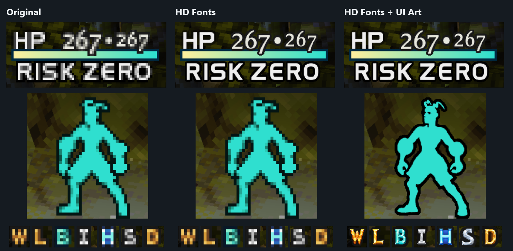

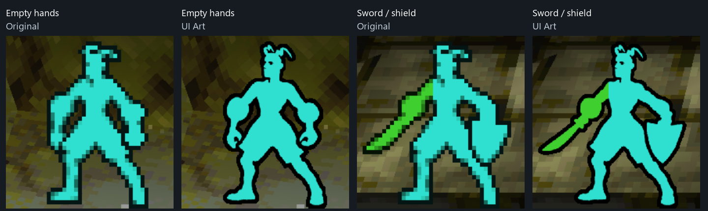

[Release notes](RELEASE-NOTES.md) · [Art direction](docs/ART-DIRECTION.md).

---

## v0.6 beta — 2026-10-17

- Added all seven material initials with reviewed metallic shading and thick dark borders.
- Kept the selected letter designs and corrected W to its original sprite footprint.
- 103 PNGs. The preceding 101 font files are unchanged.
- Includes the combat-text and popup-sign work recorded below.

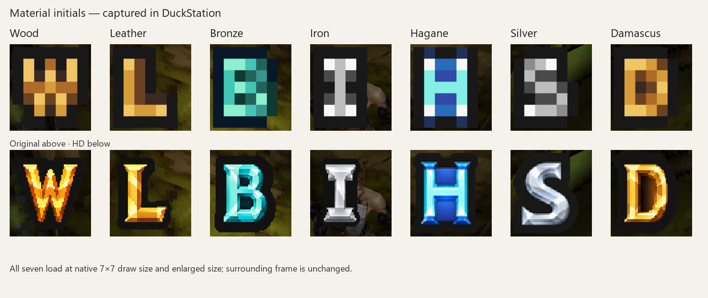

[Equipment-menu comparison](docs/images/equipment-materials-v0.6.png) · [Testing](docs/TESTING.md).

## v0.5 development — included in v0.6

- Added 66 fixed-word sprites: combat/status text, interaction notices and affinity popups.
- Reconstructed the original angled 5, asymmetric percent symbol and distinctive letter details.
- Kept native popup colours, dark surrounds and steady/flash effects.
- Sharpened the popup +/− signs with square dark borders.
- Checked all new sprites in Windows; word pairs and HP/MP numbers stay separate.

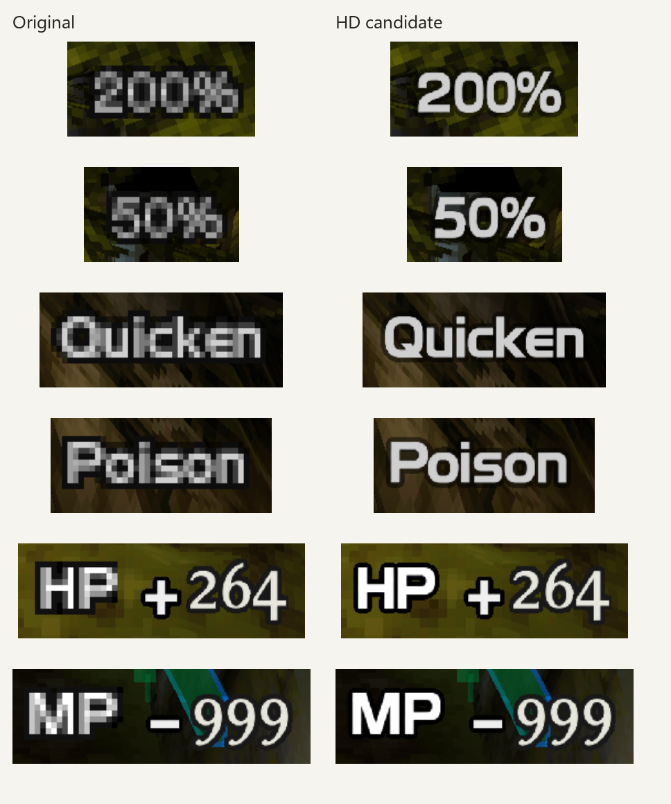

[Spacing comparison](docs/images/combat-spacing-v0.5.png) · [Fixed labels and coloured popups](docs/images/fixed-labels-v0.5.png).
[Popup signs](docs/images/affinity-signs-v0.5.png).

101 replacement PNGs. Dialogue and non-text artwork are unchanged.
The maintainer tested the preceding package on Android. The popup-sign
correction and broader gameplay checks remain pending there.

## [v0.4 beta](https://github.com/diodiogod/vagrant-story-hd-dialogue-font/releases/tag/v0.4-beta) — 2026-10-16

- Reconstructed MAP, SAVE, CLEAR and TIME.
- Restored dark surrounds on HP, MP, RISK and WT.
- Added a soft neutral glow to white menu text.
- Corrected spacing, baselines and character heights across the menu font.
- Checked the compact UI alphabet and digits; corrected spacing and two letter heights.
- Restored native dark surrounds across all 36 compact UI letters and digits.

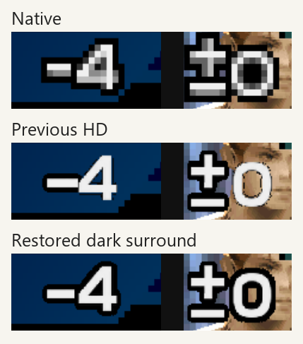

[Equipment-label comparison](docs/images/compact-ui-labels-v0.4.png).

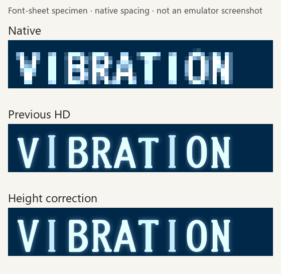

[Full alphabet comparison](docs/images/font-height-families-preview.png).
The INFORMATION heading's faint native-text ghost remains a [known issue](docs/TESTING.md).

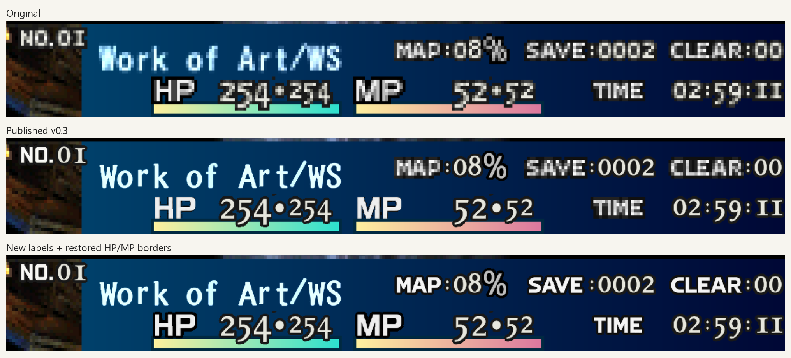

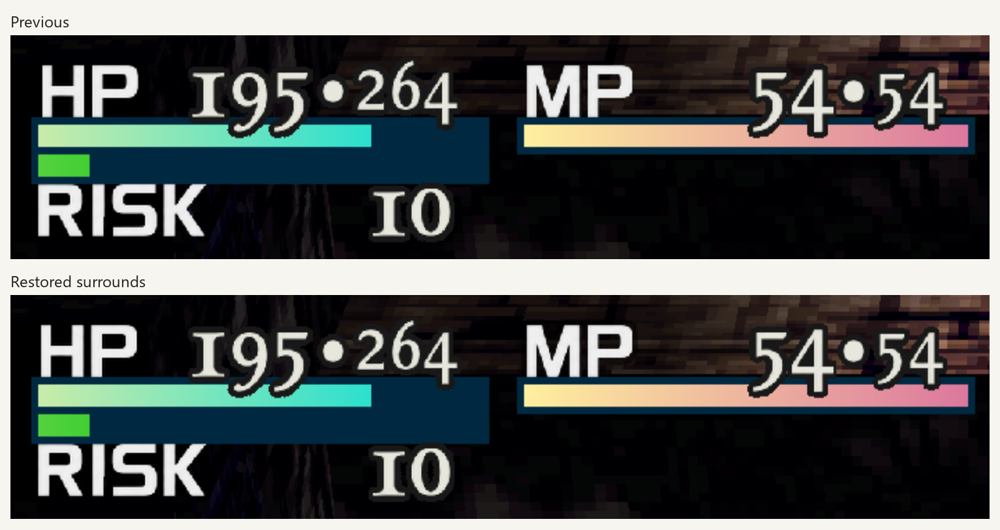

### Soft menu glow

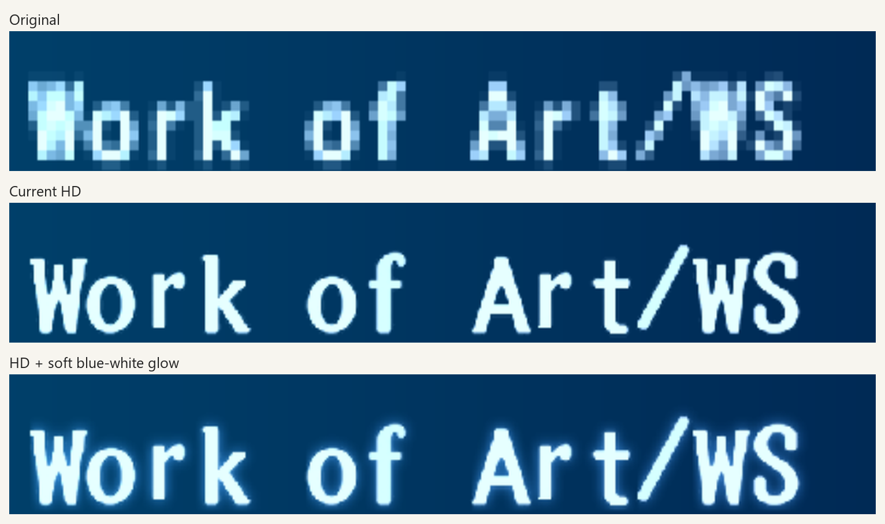

The glow stays grayscale, matching the original palette, and is shared by
save names and white menu text.
[Green-menu comparison](docs/images/green-menu-glow-preview.png).

59 replacement PNGs; the seven dialogue textures are unchanged.

## [v0.3 beta](https://github.com/diodiogod/vagrant-story-hd-dialogue-font/releases/tag/v0.3-beta) — 2026-10-15

- Added menu fonts, HUD letters/numbers, fixed labels and punctuation.
- Restored value-digit borders and sharpened the HP/MP separator.
- Added Android installation tips and the PGXP compatibility note.

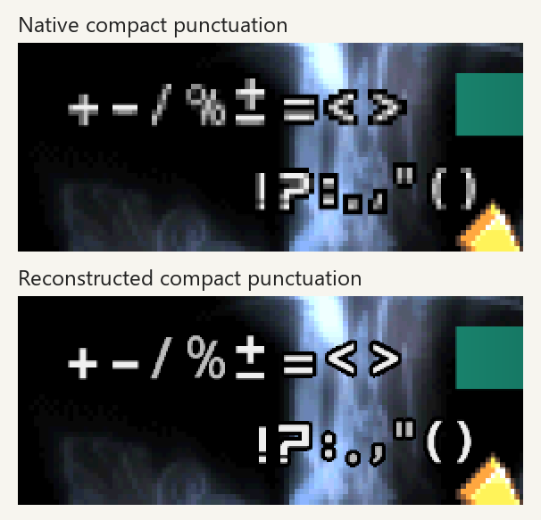

## [v0.2 beta](https://github.com/diodiogod/vagrant-story-hd-dialogue-font/releases/tag/v0.2-beta) — 2026-10-14

- First original-style dialogue release: 123 glyphs, seven palettes.

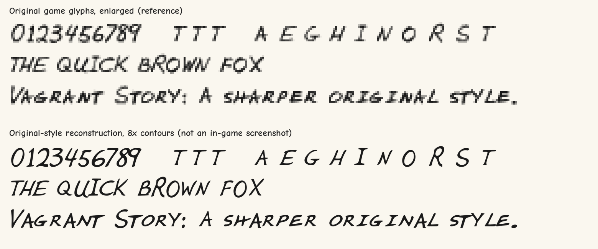
