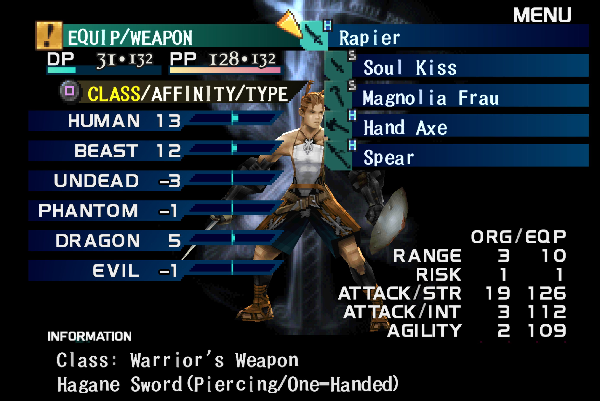
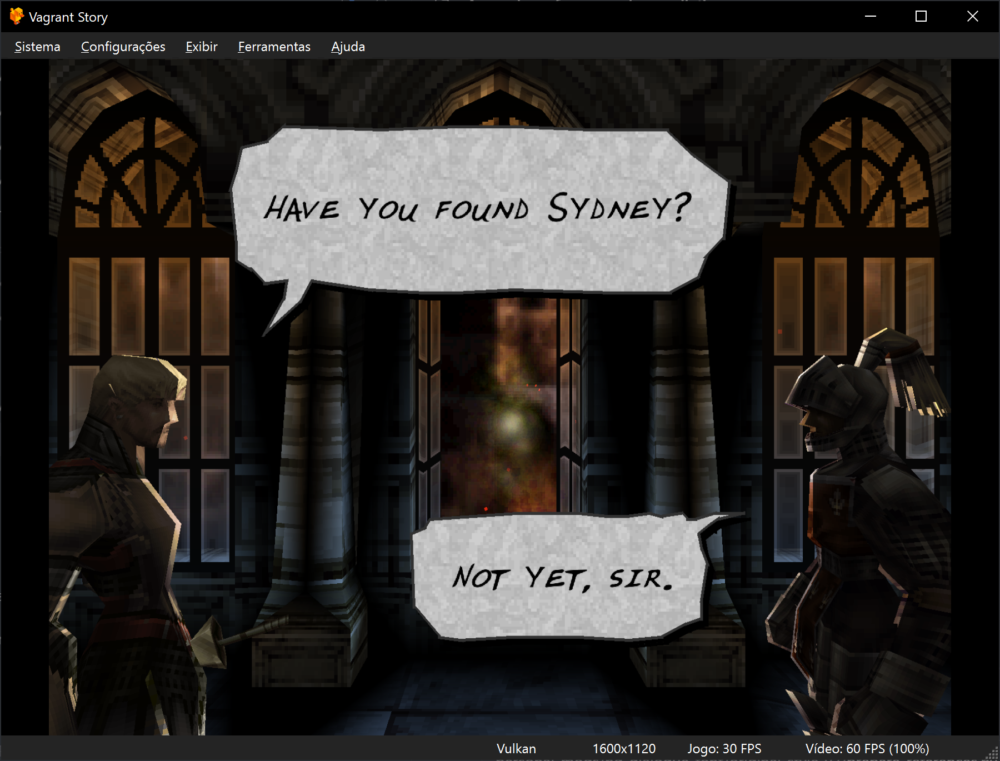
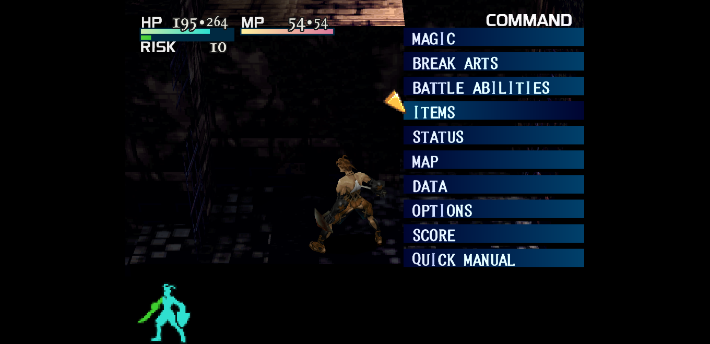

# Vagrant Story Original Style HD Fonts

An 8x font pack for **DuckStation · Vagrant Story USA (SLUS-01040)**.
Sharper dialogue, menus and HUD text, keeping the original style and spacing.

**v0.3 beta:** [Android ZIP](https://github.com/diodiogod/vagrant-story-hd-dialogue-font/releases/download/v0.3-beta/vagrant-story-font-v0.3-android.zip) · [Desktop ZIP](https://github.com/diodiogod/vagrant-story-hd-dialogue-font/releases/download/v0.3-beta/vagrant-story-font-v0.3-desktop.zip) · [Release notes](RELEASE-NOTES.md)

## What's new

- 145 reconstructed menu glyphs, alongside the existing 123 dialogue glyphs.
- HD HUD letters, labels and small/large numbers with dark borders.
- Sharper punctuation and a round HP/MP separator.
- 51 replacement PNGs. Other game artwork stays original.

**Rough font/text progress: 80%.** Remaining fixed labels and rare symbols are
on the [roadmap](docs/COVERAGE.md). Other UI artwork is planned for later.

Latest source includes [save labels, restored borders and menu-font alignment fixes](CHANGELOG.md).

## Install

### Android

1. Download the **Android ZIP** and leave it zipped.
2. Stop the game, then use **Transfer Data → ZIP file → Import** in DuckStation.
3. Select the ZIP and choose **Textures** if asked.
4. Enable **Texture Cache** and **Texture Replacements** with a hardware renderer.
5. Set **Texture Filtering** and **Sprite Texture Filtering** to **Nearest Neighbor**.
6. Restart the game. Try 4x/5x internal resolution.

**Android 0.1-8969:** disable **PGXP Geometry Correction** in Vagrant Story's
per-game settings to avoid distorted menu letters. This loses PGXP's 3D
improvements. Windows 0.1-12083 passed our menu test with PGXP on;
newer Android builds haven't been tested. [Details](docs/PGXP.md).

### Desktop

Extract the **Desktop ZIP** into DuckStation's `textures` folder so it contains
`textures/SLUS-01040/replacements/`. Enable **Texture Cache** and
**Texture Replacements**, set **both texture filters to Nearest Neighbor**,
and restart the game.

Upgrading an experimental menu/UI pack? Back it up and remove its old
replacements first. Published dialogue-only v0.2 can be upgraded by import.
[Installation help and troubleshooting](docs/INSTALL.md).

## Screenshots

[Native menu](assets/windows-command-native.png) · [HD menu](assets/windows-command-v0.3.png) · [Punctuation comparison](assets/punctuation-renderer-comparison.png)

## More

[Visual changelog](CHANGELOG.md) · [Coverage and roadmap](docs/COVERAGE.md) · [Compatibility](docs/PGXP.md) · [Testing](docs/TESTING.md) · [Method and credits](docs/CREDITS.md)

For bug reports, include a screenshot, game serial, DuckStation version,
device/renderer and PGXP/filter settings.

Unofficial fan project, made with AI-assisted reconstruction and manual review.
Original art belongs to its rights holders. No game, BIOS or emulator included.
