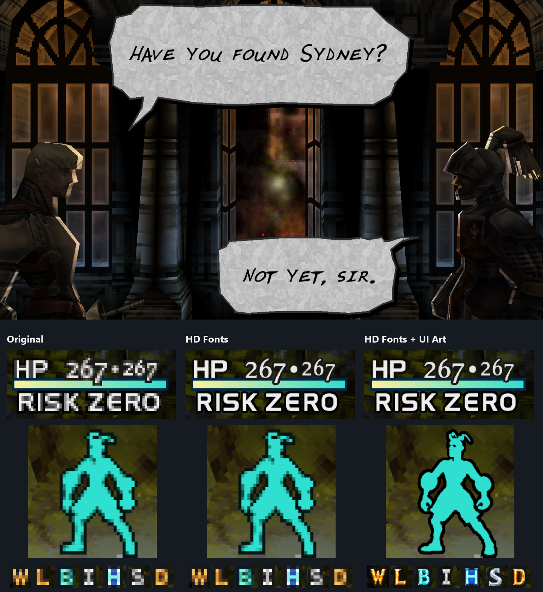
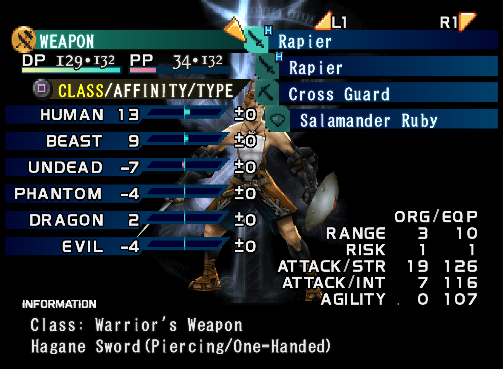

# Vagrant Story HD Fonts & UI

An 8× texture pack for **DuckStation · Vagrant Story USA (SLUS-01040)**.
Sharper dialogue, menus and HUD text, guided by the original lettering.

## Choose your edition

<!-- downloads:start -->
**v0.7 beta**

| Edition | What changes | Android | Desktop |
| --- | --- | --- | --- |
| **HD Fonts** | Dialogue, menus, HUD and combat text; original pixel artwork | [ZIP](https://github.com/diodiogod/vagrant-story-hd-dialogue-font/releases/download/v0.7-beta/vagrant-story-fonts-v0.7-android.zip) | [ZIP](https://github.com/diodiogod/vagrant-story-hd-dialogue-font/releases/download/v0.7-beta/vagrant-story-fonts-v0.7-desktop.zip) |
| **HD Fonts + UI Art** · WIP | Same fonts, plus material badges and body silhouettes | [ZIP](https://github.com/diodiogod/vagrant-story-hd-dialogue-font/releases/download/v0.7-beta/vagrant-story-ui-art-v0.7-android.zip) | [ZIP](https://github.com/diodiogod/vagrant-story-hd-dialogue-font/releases/download/v0.7-beta/vagrant-story-ui-art-v0.7-desktop.zip) |
<!-- downloads:end -->

Both editions share the same fonts. The original pixel art is part of the game's
character, so our sprite interpretations stay optional. [Art direction](docs/ART-DIRECTION.md).

## What's new

- Two editions: HD Fonts and HD Fonts + UI Art.
- New body-status silhouettes for equipped and empty-hand poses in the art edition.
- Material badges stay with the optional artwork; both editions share all 101 font textures.

**Rough font/text progress: 90%.** Buttons and other UI artwork remain in progress.
[Roadmap](docs/COVERAGE.md) · [Release notes](RELEASE-NOTES.md) · [Visual changelog](CHANGELOG.md).

## Install

**Install one edition.** When switching, remove the previous replacement files
first—importing another ZIP does not remove its artwork. [Switching editions](docs/INSTALL.md#switching-editions).

### Android

1. Download your edition's **Android ZIP** and leave it zipped.
2. Stop the game, then use **Transfer Data → ZIP file → Import**. Choose **Textures** if asked.
3. Enable **Texture Cache** and **Texture Replacements** with a hardware renderer.
4. Set **Texture Filtering** and **Sprite Texture Filtering** to **Nearest Neighbor**.
5. Restart the game. Try 4×/5× internal resolution.

**Android 0.1-8969:** turn off **PGXP Geometry Correction** for this game to avoid
distorted menu letters. [Compatibility](docs/PGXP.md).

### Desktop

Extract your edition's **Desktop ZIP** into DuckStation's `textures` folder,
giving you `textures/SLUS-01040/replacements/`. Enable **Texture Cache** and
**Texture Replacements**, set **both texture filters to Nearest Neighbor**,
and restart the game. [Installation help](docs/INSTALL.md).

## Screenshots

[UI borders](docs/images/compact-ui-labels-v0.4.png) · [Menu heights](docs/images/font-heights-preview.png) · [Save labels](docs/images/save-labels-preview.png)

[Combat text](docs/images/combat-labels-v0.5.png) · [Word spacing](docs/images/combat-spacing-v0.5.png) · [Fixed labels and popups](docs/images/fixed-labels-v0.5.png) · [Affinity signs](docs/images/affinity-signs-v0.5.png)

[Material badges](docs/images/material-badges-v0.6.png) · [Body silhouettes](docs/images/body-silhouettes-v0.7.png)

## More

[Visual changelog](CHANGELOG.md) · [Coverage and roadmap](docs/COVERAGE.md) · [Compatibility](docs/PGXP.md) · [Testing](docs/TESTING.md) · [Method and credits](docs/CREDITS.md)

Earlier dialogue-only downloads remain in [older releases](https://github.com/diodiogod/vagrant-story-hd-dialogue-font/releases).

For bug reports, include a screenshot, edition, game serial, DuckStation version
and device/renderer settings.

Unofficial fan project. Art direction and interpretation by
[diodiogod](https://github.com/diodiogod). Original art belongs to its rights
holders. No game, BIOS or emulator included.
