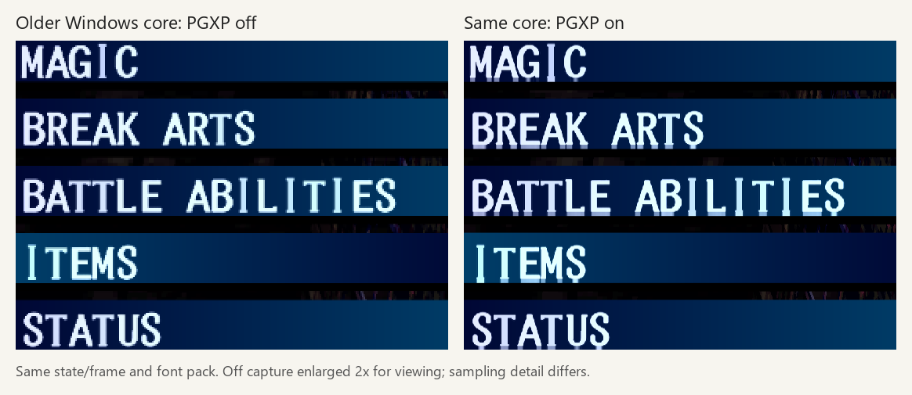

# PGXP and HD font compatibility

Investigated 2026-10-15 with the same 51-PNG pack shipped as v0.3 beta.

## What users should do

On Android DuckStation **0.1-8969-g611bb8fb4**, disable **PGXP Geometry
Correction in Vagrant Story's per-game graphics settings** if HD menu letters
show horizontal bands or misplaced-looking edges. Keep texture replacements,
the texture cache, internal resolution scaling and both Nearest filters.

This preserves the HD lettering but loses PGXP's 3D anti-wobble and perspective
benefits. An emulator containing the corrected texture-coordinate handling
is the long-term solution. No newer Android build was tested or supplied here.

## Tested versions

| Version | Observation |
| --- | --- |
| Android 0.1-8969-g611bb8fb4 | Maintainer reports menu artifacts when enabling PGXP, absent when disabled |
| Windows 0.1-8971 | Same lower-edge bands reproduced with PGXP on; its texture shader is byte-identical to Android 8969's |
| Windows 0.1-12083-g00e299795 | Tested command-menu letter pixels unchanged with PGXP off/on; no corresponding font problem |

*Actual Vulkan Present captures from archived Windows 8971. PGXP-off output
was 800x612 and PGXP-on output 1600x1224. The off image is enlarged uniformly
2x for this qualitative comparison; this pair does not support pixel-equality
claims. Both runs used 5x internal resolution and the same saved scene/frame.*

The current Windows comparison used matching output dimensions, saved scene,
frame 3000, Vulkan 5x and both filters Nearest. The foreground lettering
changed by zero pixels. Native-font controls showed the same PGXP background
effect as the HD pack over the fixed menu region, separating text from expected
3D changes. See [current-core measurements](evidence/pgxp-current-core.json).
The automated runs configured PGXP before startup; live toggling was reported
by the maintainer and was not independently automated.

## Why a 3D setting affects UI letters

PGXP also enables texture-coordinate limits in the hardware renderer.
Textured UI sprites use the affected cached-texture sampling path. The old
shader clamps floating coordinates before retaining their fractional part,
which can repeat an HD subpixel sample near a sprite's final native texel.
This fine-detail loss is especially visible in replacement fonts.

DuckStation's upstream commit
[`bdeeece` — GPU/HW: Clamp after round with round upscaling fix](https://github.com/stenzek/duckstation/commit/bdeeecefa78639de30098df0d5abf2565a4b3faa)
(2025-11-09) revises this path: integer coordinates are constrained while the
original fractional coordinates are retained for cached-page sampling.
Source inspection and the old/current version tests strongly support this
explanation. An isolated patched emulator was not built to bisect the cause.

The PNG positions and game advance widths do not change when PGXP is toggled.
There is no verified pack-only workaround. “Disable on 2D Polygons” controls
geometry and is not a verified fix for the older sprite-sampling issue.

The newer Windows result is limited to the tested menu and settings; it does
not certify every later emulator version or imply an official Android update
with this correction is available.
